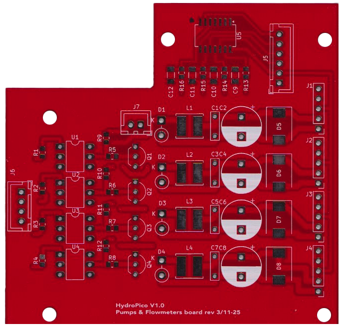
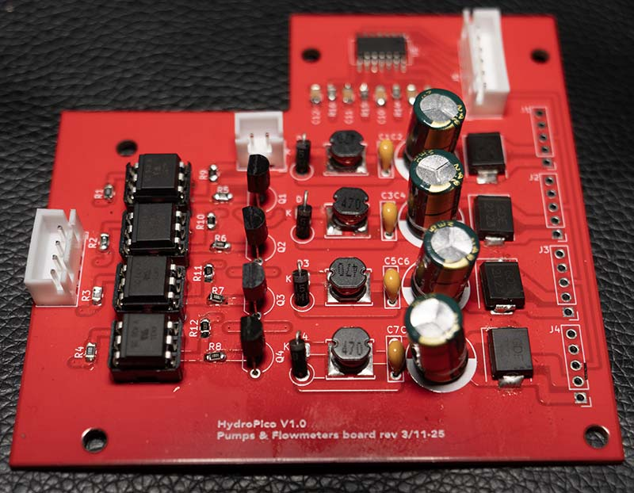

# Pumps & Flowmeters board for HydroPico 1.0

[> Français](#français)

Hydropico is an abandoned project for a hydroponic cultivation control station that I designed and built. It was too complex and too restrictive, so I abandoned the project even though it was almost finished. Here is one of the system's circuit boards, as an example. The images show the V1. 





This board is used to control 5V motors submerged in bottles containing solutions (pH+ and pH-, Plagron A and B), whose tubes are fitted with flow meters and dip into the grow tank. The system regularly monitors and adjusts the solution in the grow tank by injecting one or more products and circulating the solution with a powerful air pump. The entire system is controlled by a script, so I developed a scripting engine using a simple language; here is an example of the code:

```Hydropico scripting language
while (solution.ph > 6.5) {
    pumpfm["PH-"].inject = 4
    relay[8].on
    delay 30
    relay[8].off;
    delay 30
}

if (solution.ec < 2500 && !pumpfm["Plagron A"].error && !pumpfm["Plagron B"].error) {
    // Inject 4 units of Plagron A (pump 3)
    pumpfm["Plagron A"].inject = 4
    // Activate air pump for 15 seconds
    relay[8].on
    delay 15
    relay[8].on;
    // Inject 4 units of Plagron B (pump 4)
    pumpfm["Plagron B"].inject = 4
    // Activate air pump for 15 seconds
    relay[8].on
    delay 15
    relay[8].on;
    // Wait for 30 seconds before checking EC again   
    delay 30
}

every (8 hours) {
    // Activate inside fan
    relay["Inside Fan"].on
    delay 120
    relay["Inside Fan"].off
}
```

I designed this board because I was having EMI issues with the pumps that were causing the I²C bus to crash. The filtering is way too elaborate, but I was fed up with those random crashes that were driving me crazy. The cables from the pumps to the board also have ferrite rings that were specifically chosen for this project.

The KiCad project published here is a V2 that was never built. A much smaller V3 was also in the works when I gave up on the project.

The TVS diodes used on the first PCB were oversized (SMCJ5.0A). For other similar projects, I’ve used SMAJ5.0A diodes, which are more than sufficient. The pumps used in this project draw a maximum of 180 mA.



-----------------------------------------------------------------------------------------------------------------------------

### Français

Hydropico est un projet avorté de station de contrôle de culture hydroponique que j'ai conçu et fabriqué. Trop complexe, trop contraignant, j'ai abandonné le projet alors qu'il était quasiment terminé. Voici, à titre d'exemple, l'une des cartes du système. Les images montrent la V1. 


Cette carte sert à piloter des moteurs 5V immergés dans des flacons contenant des solutions (PH+ et PH-, Plagron A et B), dont les tuyaus sont terminés par un débit-métre, et plongent dans le bac de culture. Le système surveille et ajuste la solution dans le bac de culture régulièrement, en injectant un ou plusieurs produits et en brassant la solution avec une pompe à air puissante. Tout le système est contrôlé par un script, j'ai donc développé un moteur de script avec un langage simple, voici un exemple de code : 

```Hydropico scripting language
while (solution.ph > 6.5) {
    pumpfm["PH-"].inject = 4
    relay[8].on
    delay 30
    relay[8].off;
    delay 30
}

if (solution.ec < 2500 && !pumpfm["Plagron A"].error && !pumpfm["Plagron B"].error) {
    // Inject 4 units of Plagron A (pump 3)
    pumpfm["Plagron A"].inject = 4
    // Activate air pump for 15 seconds
    relay[8].on
    delay 15
    relay[8].on;
    // Inject 4 units of Plagron B (pump 4)
    pumpfm["Plagron B"].inject = 4
    // Activate air pump for 15 seconds
    relay[8].on
    delay 15
    relay[8].onn;
    // Wait for 30 seconds before checking EC again   
    delay 30
}

every (8 hours) {
    // Activate inside fan
    relay["Inside Fan"].on
    delay 120
    relay["Inside Fan"].off
}
```

Cette carte a été mise au point car j'avais des problèmes d'EMI avec les pompes qui faisaient planter le bus I²C. Le filtrage est beaucoup trop élaboré mais j'en avais marre de ces plantages aléatoires qui me rendaient fou. Les câbles des pompes qui vont vers la carte ont en plus des anneaux de ferrites choisis spécifiquement pour le projet. 

Le projet kicad publié ici est une V2 jamais réalisée. Un V3, beaucoup plus petite était aussi en projet au moment ou j'ai abandonné.   

Les TVS utilisées sur le premier PCB étaient surdimensionnées (SMCJ5.0A). Pour d'autres projets similaires, j'ai utilisé des SMAJ5.0A, largement suffisantes. Les pompes utilisées par le projet tirent au maximum 180mA.  

